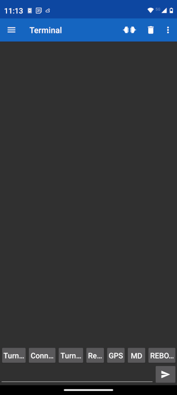
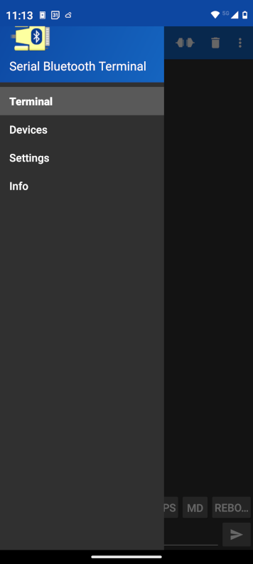
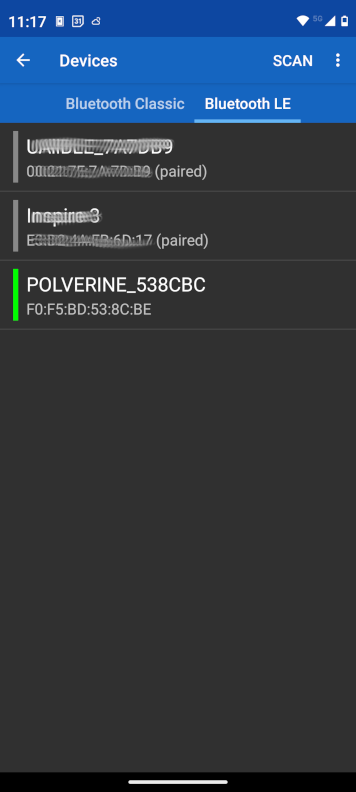
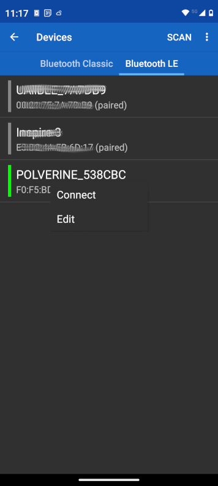
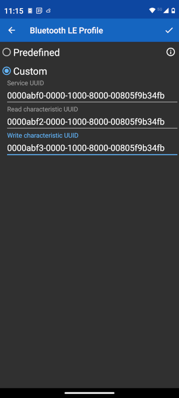
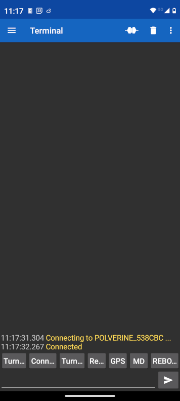
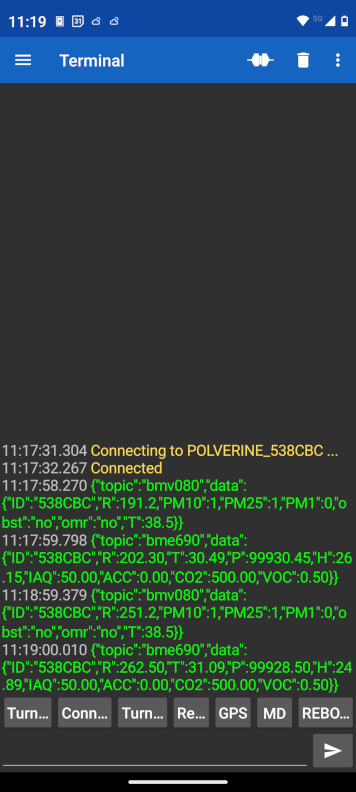

## POLVERINE_FULL_BLE_DEMO: BLE Sensors Data Collection

### An easy to use Solution

You can use [Serial Bluetooth Terminal](https://play.google.com/store/apps/details?id=de.kai_morich.serial_bluetooth_terminal) app in Android and iOS with a custom BLE serial profile to receive the data.

The data is transmitted using BLE serial emulation in two messages. Each message includes a topic field (indicating the sensor name) and a data field (containing the device’s unique SENSORID, which is the last six characters of its MAC address).

The messages are formatted in JSON, for example:

1) bmv080 message

```json
{
"topic":"bmv080",
"data":{
		"ID": "54ADD8",
		"TS": 9131.2,
		"PM10": 32,
		"PM25": 24,
		"PM1": 11,
		"obst": "no",
		"omr": "no",
		"T": 11.1
	}
}
```

2) bme690 message

```json
{
"topic":"bme690",
"data":{	
	  "ID": "54ADD8",
	  "TS": 8556.60,
	  "R": 512345.00,
	  "rawT": 34.10,
	  "T": 6.25,
	  "P": 98956.57,
	  "H": 98.75,
	  "IAQ": 73.90,
	  "ACC": 3.00,
	  "CO2": 1026.85,
	  "VOC": 125.40
	}
}
```

Field notes: `TS` is the BSEC timestamp in seconds since boot, `R` the raw MOX gas resistance in ohm, `rawT` the raw die temperature in °C, `T` is the compensated air temperature in °C, `P` the raw pressure in Pa, `H` the compensated relative humidity in %, `IAQ` the Index of Air Quality, `ACC` the IAQ accuracy (0–3, published as a moving average so it appears with decimals), `CO2` the CO₂ equivalent in ppm and `VOC` the **TVOC equivalent in ppb** (not ppm). All values except `ID` are moving averages over the publish window. In the `bmv080` message `TS` is the sensor runtime in seconds and `T` is the ESP32-S3 die temperature in °C (not the air temperature).

> **BLE MTU note:** the JSON frames are up to ~143 bytes long, but a BLE notification carries at most `MTU - 3` bytes. The client must **enable notifications** on the data characteristic and **negotiate an MTU of at least 150** to receive each frame in a single notification; with the default MTU (23) the firmware splits every frame into `MTU - 3`-byte chunks that the client has to reassemble.

### Adding Bosch SDKs to Polverine source code

The POLVERINE_FULL_BLE_DEMO communicates with the Bosch BME690 & BMV080 sensors and needs the SDKs published by Bosch Sensortec.

Those SDKs are licence-gated: their sources and compiled libraries cannot be stored in this repository, and must be downloaded by the user from the Bosch website by accepting the licence agreement, then staged under `../deps/bosch-sensortec/`.

- [BMV080 SDK r.11.2.0](https://www.bosch-sensortec.com/software-tools/double-opt-in-forms/sdk-v11-2.html) - unzip into `../deps/bosch-sensortec/BMV080-SDK/`
- [BME690 BSEC r.3.3.0.0](https://www.bosch-sensortec.com/software-tools/double-opt-in-forms/bsec-software-3-3-0-0-form.html) - unzip into `../deps/bosch-sensortec/bsec_library_v3.x/`

`bsec_integration.c` / `bsec_integration.h` also derive from Bosch example code and are not in this repository; regenerate them from your own BSEC download with:

```
python3 deps/bosch-sensortec/bsec_library_wrappers/apply_polverine_patches.py
```

**The complete, authoritative staging procedure - exact directory layout, the file-by-file list and how to verify it - is in [../deps/bosch-sensortec/README.md](../deps/bosch-sensortec/README.md). Follow it before building.**

`before_build.py` runs before compilation and aborts with the full path of the first missing file, so an incomplete staging can never turn into a confusing compiler error.

> BSEC **3.2.1.0 and older will not build**: the library tree moved from `algo/bsec_IAQ/` to `release_bin/IAQ/` in 3.3.0.0.

### Using the Android app

To see the data in Android app start the "Serial Bluetooth Terminal" app:



then select the app menù:

 

and devices menù to visualize the list of BLE devices:

 

lay the finger on the POLVERINE_XXXXXX to show the context menù:

 

select the Edit menù to edit the connection profile.

 

Confirm the Custom profile and select the connect menù.

 

Wait 1 minute to let data arrive tp the terminal:

 

