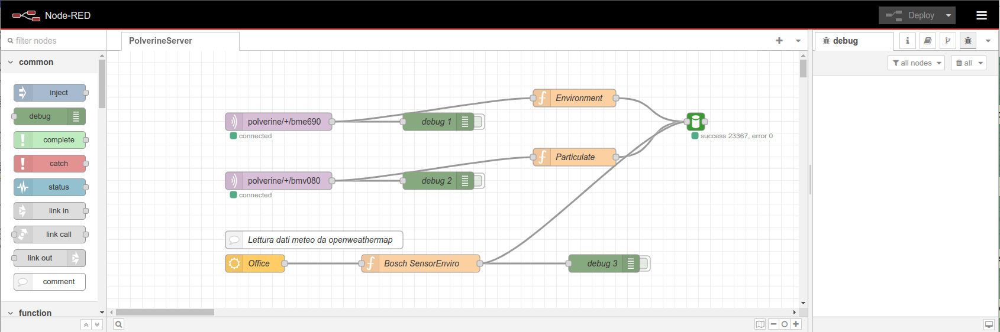
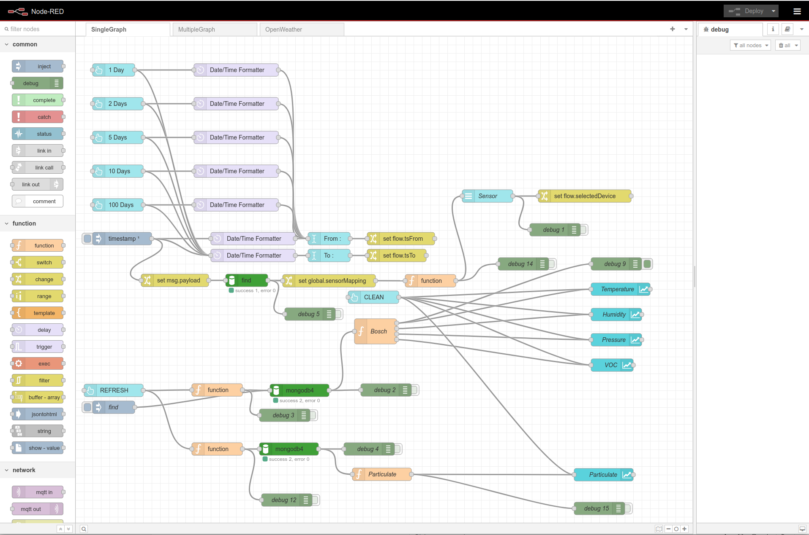
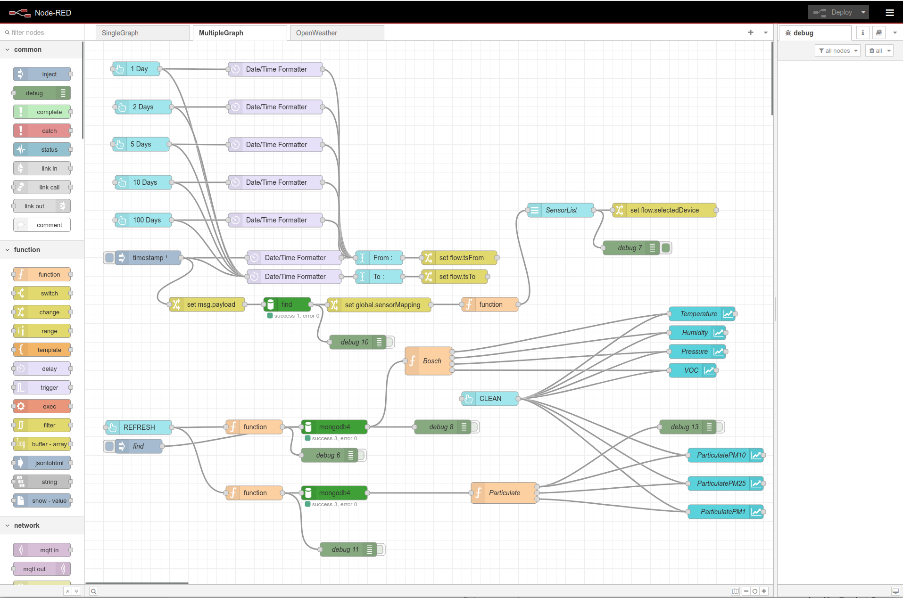
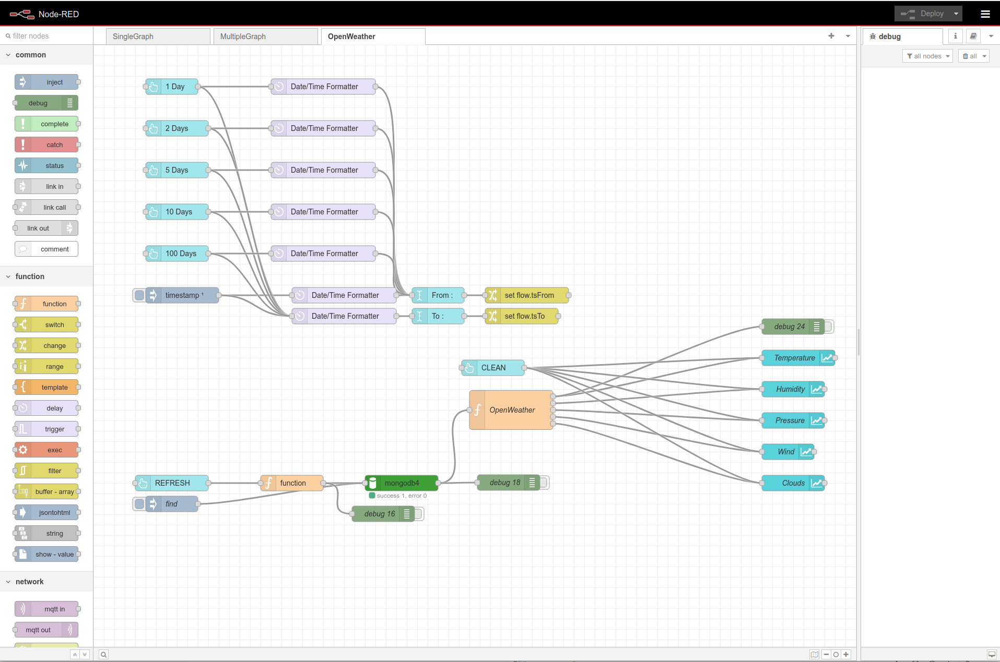
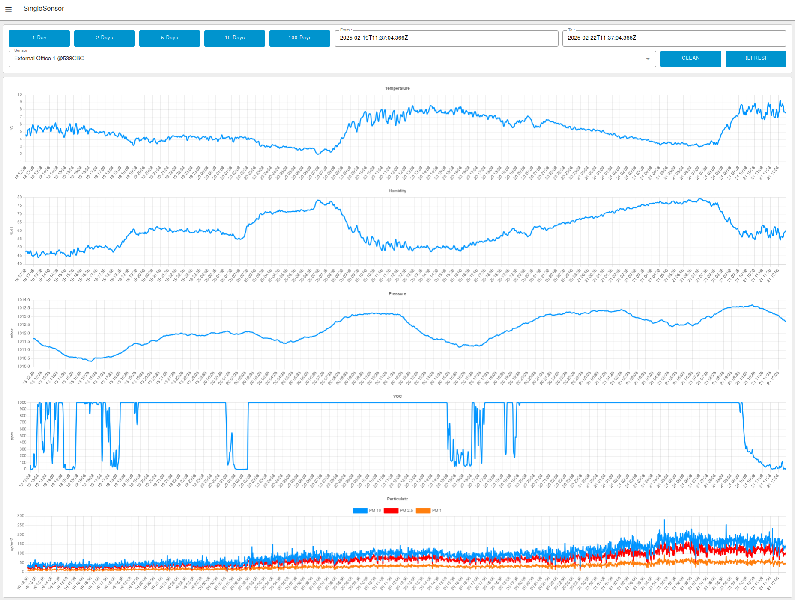
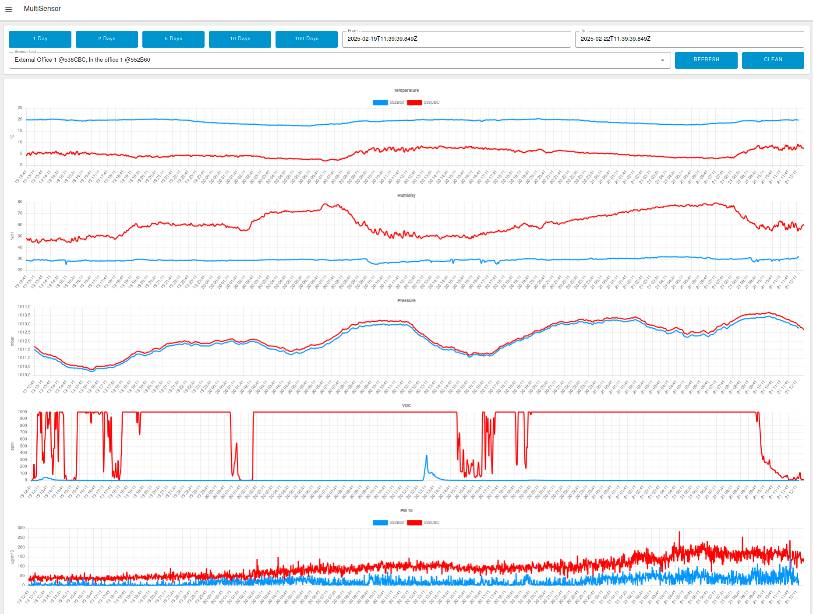
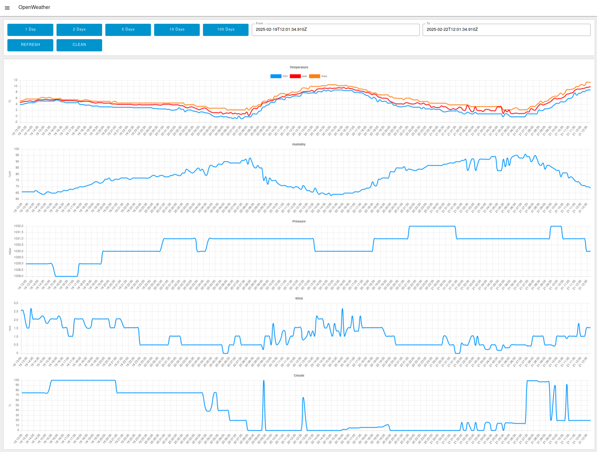
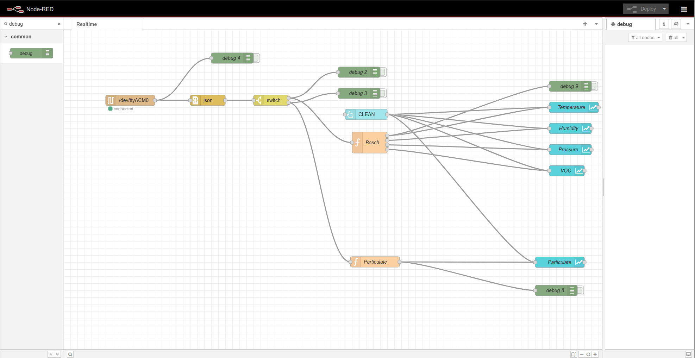
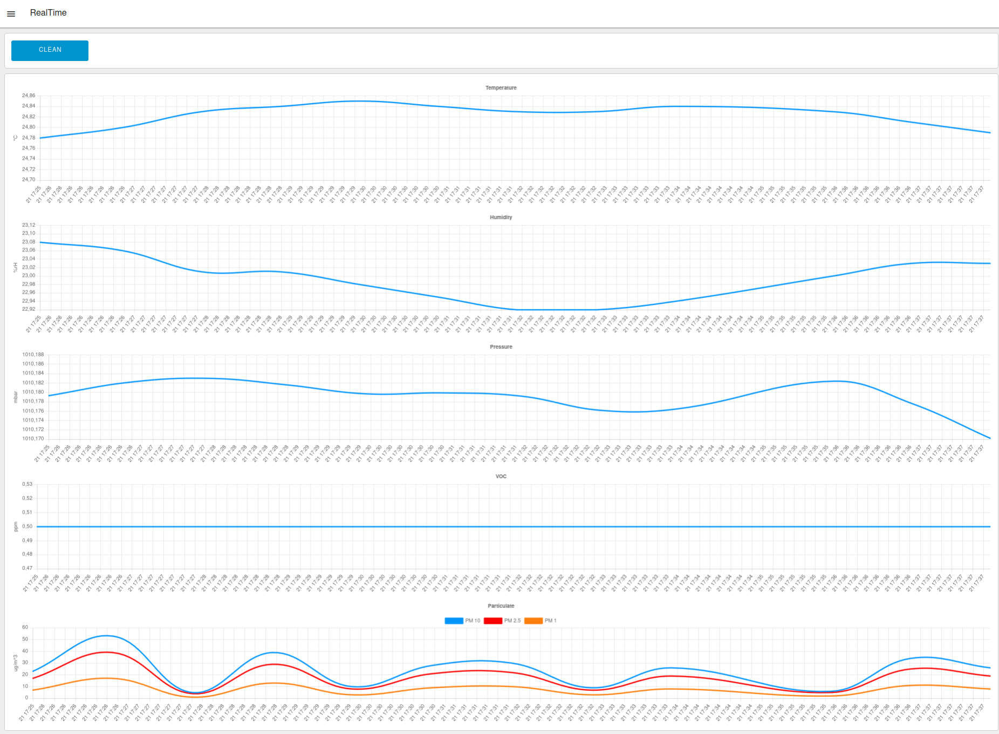

## NodeRED flows

### Files

| File | Purpose |
|---|---|
| `server_flows.json` | Server side. Subscribes to MQTT `polverine/+/bme690` and `polverine/+/bmv080` (POLVERINE_FULL_MQTT_DEMO) and inserts the frames into the MongoDB `Polverine` database, collections `DataEnvironment` (BME690) and `DataParticulate` (BMV080); a periodic OpenWeatherMap query is stored in `Weather`. See [../mongodb/README.md](../mongodb/README.md) for the schema. |
| `server_with_dashboards.json` | Same server flow plus a live Node-RED dashboard (`node-red-dashboard` tabs BME690 / Plots / Additional Info / BMV080) fed directly from the MQTT frames. |
| `client_flows.json` | Client side. History dashboards (single sensor, multi sensor, OpenWeather) reading back from the MongoDB collections above. |
| `client_rt_flows.json` | Client side, no broker or database. Real-time plot from the USB console stream of POLVERINE_DEMO: `serial in` on `/dev/ttyACM0` at 230400 baud, JSON frames split by topic (`bme690` / `bmv080`). |

### Required palette nodes

Install via *Manage palette* before importing (note the two dashboard generations — they are different packages):

| Flow | Palette nodes |
|---|---|
| `server_flows.json` | `node-red-contrib-mongodb4`, `node-red-node-openweathermap` |
| `server_with_dashboards.json` | the two above + legacy `node-red-dashboard` (Dashboard 1.x — this flow still uses `ui_base`/`ui_chart`) |
| `client_flows.json` | `node-red-contrib-mongodb4`, `@flowfuse/node-red-dashboard` (Dashboard 2.0), `node-red-contrib-moment` |
| `client_rt_flows.json` | `node-red-node-serialport`, `@flowfuse/node-red-dashboard` (Dashboard 2.0) |

> **VOC unit change (BSEC 3.3.0.0).** Since the BSEC 3.3.0.0 migration the firmware publishes `VOC` as TVOC equivalent in **ppb** (`BSEC_OUTPUT_TVOC_EQUIVALENT`); before it was breath-VOC equivalent in **ppm**. The flows in this folder now pass the value through and label it `TVOC (ppb)`. Flows exported before the migration assumed VOC in ppm (the dashboard flow multiplied it by 1000), and any history recorded in MongoDB before the migration is breath-VOC in ppm, so a 1000x step in the `VOC` field marks the firmware change.

### Server flow

### Client Flows

### Client Dashboard

### Client Real-Time Flow and Dashboard (`client_rt_flows.json`)

